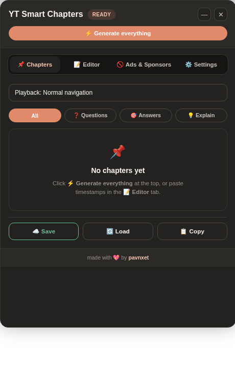
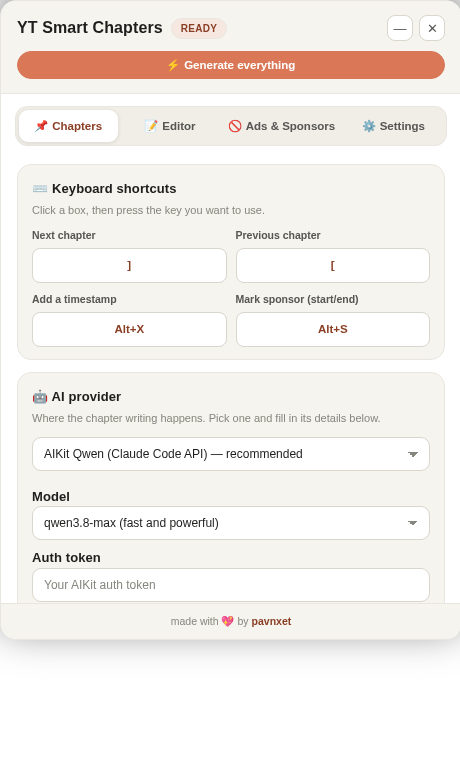

<p align="center">
  
</p>

<h1 align="center">YT Smart Chapters Pro</h1>

<p align="center">
  <strong>AI question, answer and sponsor timestamps for long YouTube lectures — with keyboard skipping that actually respects your syllabus.</strong>
</p>

<p align="center">
  <a href="https://github.com/pavnxet/yt-timestamp-skipper/releases"></a>
  <a href="manifest.json"></a>
  <a href="#-browser-support"></a>
  <a href="LICENSE"></a>
  <a href="https://github.com/pavnxet/yt-timestamp-skipper/stargazers"></a>
</p>

<p align="center">
  <a href="#-installation">Install</a> ·
  <a href="#-quick-start">Quick start</a> ·
  <a href="docs/README.md">Documentation</a> ·
  <a href="#-faq">FAQ</a> ·
  <a href="#-keyboard-shortcuts">Shortcuts</a>
</p>

---

**YT Smart Chapters Pro** is a Chrome extension (Manifest V3) that turns a two-hour YouTube lecture into a clickable chapter list. It reads the video's transcript, asks your AI provider for question / correct-option / explanation timestamps, draws them on the progress bar, and lets you jump between them with `[` and `]` — so you can revise an MCQ paper without ever landing on an explanation you don't need. It also finds sponsor reads and uploads them to SponsorBlock, saves every list to your own Turso database, and can post the timestamps as a comment under the video.

Built for competitive-exam aspirants, students and power viewers who watch long-form educational video at speed.

## Contents

- [What it does](#-what-it-does)
- [Screenshots](#-screenshots)
- [Installation](#-installation)
- [Quick start](#-quick-start)
- [Features](#-features)
- [Configuration](#-configuration)
- [Keyboard shortcuts](#-keyboard-shortcuts)
- [AI providers](#-ai-providers)
- [Documentation](#-documentation)
- [FAQ](#-faq)
- [Repository structure](#-repository-structure)
- [Browser support](#-browser-support)
- [Contributing](#-contributing)
- [License & attribution](#-license--attribution)

## 🎯 What it does

Four things, in order:

1. **Reads the transcript** — from YouTube's own transcript panel (modern tabbed and legacy layouts) or, when that is unavailable, from TranscriptAPI.
2. **Writes the chapters** — your AI provider returns a Markdown table of question starts, correct-option reveals and explanation starts. Long lectures are chunked and merged.
3. **Draws and navigates** — the table becomes chapters, progress-bar markers and the skip targets for the hotkeys, the mini player and the section filter.
4. **Saves and shares** — to your Turso database, and optionally as a comment under the video with an attribution watermark.

> No account, no analytics, no server of ours. Your API keys and chapter lists live in `chrome.storage.local` and in the database you point it at.

## 📸 Screenshots

| Dashboard | Settings |
| :---: | :---: |
|  |  |

## 🚀 Installation

**Step 1:** Clone the repository (or download the ZIP and unpack it).

```bash
git clone https://github.com/pavnxet/yt-timestamp-skipper.git
```

**Step 2:** Open `chrome://extensions/` in Chrome, Edge, Brave or Opera.

**Step 3:** Turn on **Developer mode** (top right).

**Step 4:** Click **Load unpacked** and pick the folder that contains `manifest.json`.

**Step 5:** Open any YouTube video and click the ⚡ button (or the extension icon) to open the dashboard.

> **Updating?** Click **Reload** on the extension card. Versions from 3.2 onward add the `clipboardRead` and `youtube-nocookie.com` permissions, so the browser asks you to re-approve once.

Full walkthrough, including unpacked-install troubleshooting: [docs/installation.md](docs/installation.md).

## ⚡ Quick start

1. Open the dashboard → **Settings**.
2. Pick an AI provider (**AIKit** is preconfigured, or paste an OpenRouter / OpenAI-compatible key).
3. Go to **Editor** → **📜 Get transcript** (or just hit **Generate** — it fetches the transcript itself).
4. Wait for the table. Chapters appear as cards, markers appear on the progress bar.
5. Press `]` to jump to the next question, `[` to go back.
6. **☁️ Save** to your Turso DB, or **💬 Comment** to post the list under the video.

## ✨ Features

### 1. 🤖 AI question & timestamp specialist
- Works with **AIKit (Claude Code protocol / Qwen)**, **OpenRouter** and **any OpenAI-compatible endpoint** (custom profiles supported).
- Produces three timestamps per question: **question start**, **correct option reveal** and **explanation start**.
- Smart Markdown-table parser turns the model's reply straight into chapters, markers and skip targets.

### 2. 🏷️ Multi-select section filter
- Chips for **Questions**, **Answers** and **Explain** toggle independently.
- The selection drives the chapter list, the progress-bar markers **and** the `[` / `]` skip targets — pick Questions + Answers to revise an MCQ paper and skip every explanation.
- **All** resets the filter; turning the last chip off falls back to All.

### 3. 🖼️ Works inside embedded players
- Runs in `youtube.com/embed`, `youtube-nocookie.com` and the legacy `/v/` player, on **any host site** — course platforms, blogs, your own dashboard.
- A ⚡ launcher on the host page opens the panel over the player.
- Embeds have no transcript panel, so transcripts there come from the TranscriptAPI path.

### 4. 📜 Autonomous transcript extraction
- Reads YouTube's tabbed *"In this video"* transcript view (`transcript-segment-view-model`), the legacy renderer, and a node-walk fallback — while ignoring the hidden dummy panel.
- Falls back to TranscriptAPI for restricted or embed-only videos.
- Lines are never emitted without a timecode; an untimed transcript is treated as a failure, not a result.
- **📋 Auto-copy** option grabs the transcript of every video you open and puts it on your clipboard.

### 5. 🚫 SponsorBlock detection & upload
- Detects sponsor reads, self-promotion, intros, outros, previews, interaction reminders and filler.
- **📥 Paste segments** imports a table or `[MM:SS]-[MM:SS]` intervals from your clipboard in one click; **➕ Add manually** (**Alt + S**) marks a single interval.
- A safety gauge warns before removable segments pass **80%** of the video.
- Uploads every interval to SponsorBlock with your private user ID.

### 6. ⏱️ Chapter scroll that follows playback
- Tracks the current chapter while the video plays and keeps it in view, no manual scrolling.

### 7. 💬 Auto-comment with watermark
- Posts the list under the video on **☁️ Save** or **Auto Save Sync**:

  ```text
  📌 Questions & Answers Timestamps:
  Q1: Question 02:33 | Answer 03:30 (A)
  Q2: Question 05:36 | Answer 07:02 (B)
  Q3: Question 07:53 | Answer 08:44 (D)

  ━━━━━━━━━━━━━━━━━━━━
  made with 💖 by pavnxet
  https://github.com/pavnxet/yt-timestamp-skipper
  ```

- The `Answer` time is where the **correct option is revealed**, not where the explanation starts.

### 8. 🔔 Completion chime
- Built-in sound, a custom URL, or a local file upload, with a volume slider and a test trigger.

### 9. ⌨️ Hotkeys and looping
- Rebindable jump keys, a note marker at the current time, sponsor marking, and **Normal / Chapter-loop** playback modes for drilling a hard discussion.

### 10. ☁️ Turso (libSQL) sync
- Save every list to your own cloud database and reload it on any device — no second AI call, no credits spent twice.

### 11. 🎨 Six UI themes
- **Warm** (default terracotta), **Neutral**, **Butter**, **Chocolate**, **Matcha**, **Stone**. Pick one in Settings.

## ⚙️ Configuration

All options live in the **⚙️ Settings** tab inside the dashboard.

| Setting | What it does | Default |
| :--- | :--- | :--- |
| Generate chapters when a video opens | Fetch the transcript and write chapters automatically | Off |
| Copy transcript to clipboard | Grab and copy the transcript of every video opened | Off |
| Auto Save & Comment | Save to Turso and post the comment when chapters are ready | Off |
| Auto upload ads to SponsorBlock | Scan and upload removable segments after chapters | Off |
| Post timestamps as a comment | Post the Q&A list under the video when you save | On |
| AI Provider | AIKit, OpenRouter, or a custom OpenAI-compatible endpoint | AIKit |
| Model | e.g. Qwen 3.8 Max, GLM 5.3, Gemma, DeepSeek | `qwen3.8-max` |
| Custom profiles | Named endpoint + key + model bundles you can switch between | — |
| Disable chunking | Send the whole transcript in one pass (for 128k-context models) | Off |
| Turso Database | `libsql://…` URL and auth token | Optional |
| TranscriptAPI key | Used when YouTube's transcript is unavailable, and always for embeds | Built-in key |
| SponsorBlock private ID | Required to upload segments | Optional |
| Sound alert | Chime, volume, custom sound file | On |
| Mini floating player | Small bottom widget with previous / next | Off |
| UI theme | Warm, Neutral, Butter, Chocolate, Matcha, Stone | Warm |
| Shortcuts | Rebind next / previous / add-note keys | `]`, `[`, `Alt+X` |

Every key is documented in [docs/configuration.md](docs/configuration.md).

## ⌨️ Keyboard shortcuts

| Key | Action |
| :--- | :--- |
| `]` | Jump to the next chapter |
| `[` | Jump to the previous chapter |
| `Alt + X` | Add the current timestamp with a custom note |
| `Alt + S` | Mark the start / end of a sponsor segment |
| `Esc` | Close the dashboard |

Next, previous and add-note are rebindable in **Settings → Shortcuts** (click the field, then press the key). Sponsor marking is fixed at `Alt + S`.

## 🔌 AI providers

| Provider | Endpoint | Auth | Notes |
| :--- | :--- | :--- | :--- |
| **AIKit** | `https://claude.aikit.club/qwen.aikit.club/v1` | AIKit token | Default. Claude Code protocol, Qwen models. |
| **OpenRouter** | `https://openrouter.ai/api/v1` | OpenRouter key | Any model OpenRouter serves. |
| **Custom** | Your own base URL | Your key | Any OpenAI-compatible chat-completions API; supports multiple saved profiles and a no-chunking toggle. |

Model choice, token cost and chunking behaviour are covered in [docs/ai-providers.md](docs/ai-providers.md).

## 📚 Documentation

| Guide | What's inside |
| :--- | :--- |
| [Getting started](docs/getting-started.md) | Install, first run, first chapter list |
| [Installation](docs/installation.md) | Unpacked install, updates, permissions explained |
| [Configuration](docs/configuration.md) | Every setting, every storage key |
| [AI providers](docs/ai-providers.md) | AIKit, OpenRouter, custom endpoints, models, chunking |
| [Transcripts](docs/transcripts.md) | Where transcripts come from and why one may be missing |
| [Chapters & filters](docs/chapters-and-filters.md) | Reading the table, section chips, markers |
| [SponsorBlock](docs/sponsorblock.md) | Detection, paste format, upload, categories |
| [Turso sync](docs/turso-sync.md) | Setting up a libSQL database and syncing lists |
| [Keyboard shortcuts](docs/keyboard-shortcuts.md) | Defaults, rebinding, conflicts |
| [Troubleshooting](docs/troubleshooting.md) | Symptom → cause → fix |
| [Architecture](docs/architecture.md) | File map, message flow, data model |
| [Development](docs/development.md) | Local workflow, conventions, release checklist |
| [FAQ](docs/faq.md) | The long version of the questions below |

There is also a free **prompt toolkit** in [docs/toolkit/](docs/toolkit/SKILL.md) — the exact prompts the extension uses for chapters, MCQ timestamps and SponsorBlock segments, so you can run the same workflow in any chat AI by hand.

## ❓ FAQ

**Does it work without an API key?**
Not for AI chapters — you need some OpenAI-compatible endpoint. AIKit ships preconfigured; OpenRouter and custom endpoints need your own key. Everything else (transcript capture, manual chapters, SponsorBlock marking, Turso sync) works without AI.

**Does it work on Shorts, live streams and embedded players?**
Yes. Video IDs are resolved from `/watch`, `/live/`, `/shorts/`, `/embed/`, `/v/` and the canonical link. Live streams have no transcript until the stream ends, so chapters there need the TranscriptAPI path.

**Will it post comments without asking?**
Only when **Post timestamps as a comment** is on *and* you press Save, or when **Auto Save & Comment** is enabled. Both are visible in Settings.

**Where is my data stored?**
Locally in `chrome.storage.local`, plus your own Turso database if you configure one. Nothing is sent to the author.

**Does it slow YouTube down?**
No polling loops on the player; the panel mounts once and reacts to navigation events. The heavy work (transcript fetch, AI call) runs in the service worker.

**Can I use it on Firefox?**
Not yet — the code targets Chrome's Manifest V3 service-worker model. See [docs/architecture.md](docs/architecture.md) for what a port would need.

**It says NO VIDEO / NO TRANSCRIPT. What now?**
[docs/troubleshooting.md](docs/troubleshooting.md) has the exact fix for both.

## 🗂️ Repository structure

```text
yt-timestamp-skipper/
├── manifest.json         # Manifest V3 config (v3.6.1)
├── background.js         # Service worker: AI providers, transcript API, SponsorBlock, Turso
├── content.js            # Core engine: transcript extraction, chapters, filters, dashboard UI
├── content.css           # Themes, glassmorphism tokens, responsive layouts
├── embed-launcher.js     # Host-page ⚡ launcher for embedded players
├── anime-wow.mp3         # Default completion chime
├── icons/                # Extension icons (16–128 px) + logo.svg
├── assets/               # Brand: logo, light/dark lockups
├── docs/                 # Guides, GitHub Pages landing page, prompt toolkit
├── old version/          # Archived v2 build, kept for reference
├── CHANGELOG.md
├── CONTRIBUTING.md
├── LICENSE               # MIT + attribution requirement
└── README.md
```

## 🌐 Browser support

| Browser | Status | Notes |
| :--- | :--- | :--- |
| Chrome (current stable) | ✅ Primary target | Manifest V3 |
| Edge (current stable) | ✅ Works | Load unpacked from `edge://extensions/` |
| Brave | ✅ Works | Same Chromium path |
| Opera / Vivaldi | ⚠️ Expected to work | Chromium-based; not verified by the author |
| Firefox | ❌ Not supported | MV3 service worker differences |

## 🤝 Contributing

Issues and pull requests are welcome. Read [CONTRIBUTING.md](CONTRIBUTING.md) first — it covers the file layout, coding conventions, how to test without publishing, and the commit style. For security problems, follow [SECURITY.md](SECURITY.md) instead of opening a public issue.

If the extension saves you an evening of scrubbing through lectures, a ⭐ on the repo genuinely helps other aspirants find it.

## 📄 License & attribution

**MIT License with Attribution Requirement.** Use it, study it, fork it, ship it — as long as credit and a link to [pavnxet](https://github.com/pavnxet) and this repository stay visible. See [LICENSE](LICENSE) for the exact terms.

---

<p align="center">
  <sub>Keywords: YouTube chapter generator · AI timestamps · MCQ timestamp extractor · lecture skipper · SponsorBlock uploader · transcript extractor · Chrome extension for students · competitive exam revision tool</sub>
</p>

<p align="center">Made with 💖 by <a href="https://github.com/pavnxet">pavnxet</a></p>
